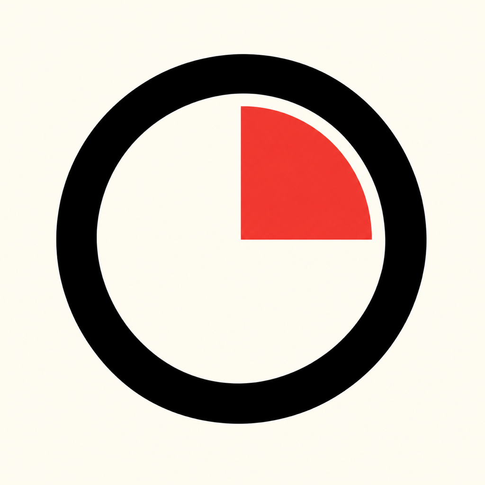
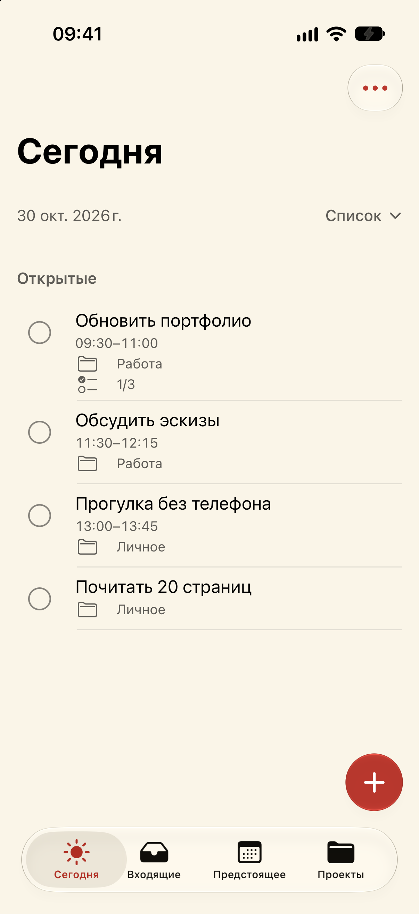
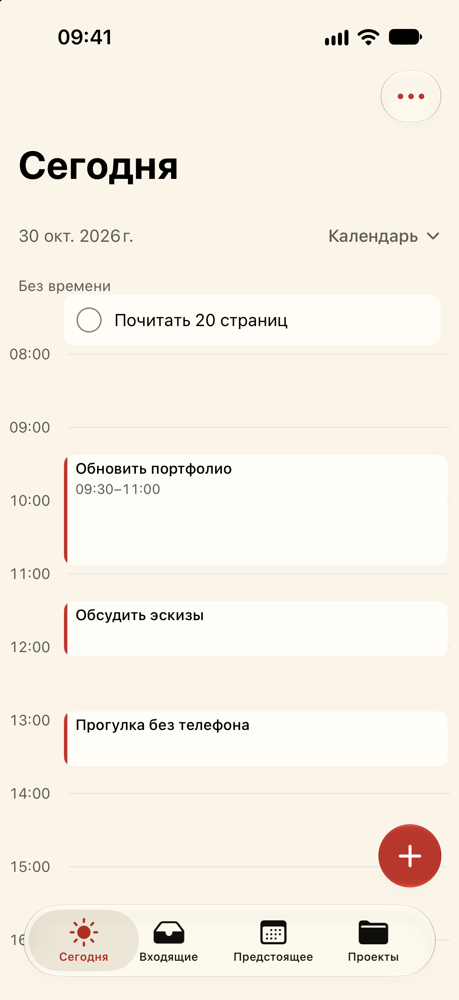
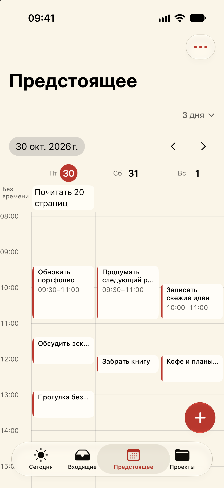
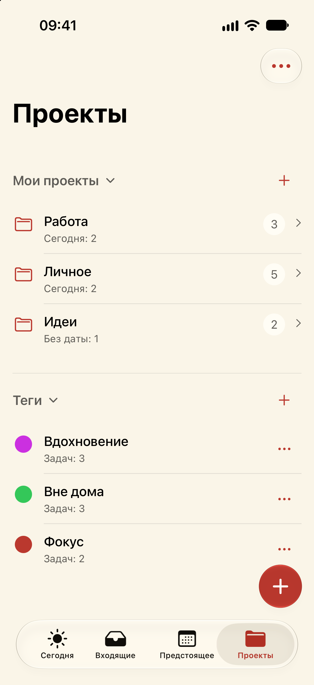

<div align="center">
  
  <h1>Orbit</h1>
  <p><strong>Делам — порядок. Важному — время.</strong></p>
  <p>Личный планировщик для iPhone: задачи, проекты и календарь в одном приложении.</p>
  <p><code>SwiftUI</code> · <code>SwiftData</code> · <code>iOS 17+</code> · <code>Без регистрации</code></p>
  <p>
    <a href="#приложение">Скриншоты</a> ·
    <a href="#возможности">Возможности</a> ·
    <a href="#календарь-и-жесты">Календарь</a> ·
    <a href="#запуск-и-разработка">Разработка</a>
  </p>
</div>

---

Соберите идеи во «Входящих», распределите дела по проектам и выделите для них время на календаре. Один и тот же план можно увидеть списком, повесткой, на шкале дня, за три дня или в календаре месяца.

**Задачи хранятся на устройстве.** Для работы не нужны аккаунт Orbit, сервер или интернет.

> **Бета · 30 октября 2026**
> Версия **0.2.0 (5)** доступна в TestFlight для внутренней и внешней групп, статус — **«Тестируется»**. В ней — плавные сворачивающиеся шапки, компактный трёхдневный календарь и последние исправления интерфейса. [Проверки выпуска](reports/TESTFLIGHT-0.2.0-5/README.md). Публикации в App Store пока нет.

## Приложение

<table>
  <tr>
    <th width="50%">Собрать день</th>
    <th width="50%">Найти время</th>
  </tr>
  <tr>
    <td align="center"></td>
    <td align="center"></td>
  </tr>
  <tr>
    <td align="center">Задачи, контекст и подзадачи — под рукой.</td>
    <td align="center">Планы занимают своё место на шкале времени.</td>
  </tr>
  <tr>
    <th>Посмотреть вперёд</th>
    <th>Разложить по полочкам</th>
  </tr>
  <tr>
    <td align="center"></td>
    <td align="center"></td>
  </tr>
  <tr>
    <td align="center">Три дня на одной шкале, без переключения экранов.</td>
    <td align="center">Проекты сверху, цветные теги снизу.</td>
  </tr>
</table>

<sub>Реальные экраны версии 0.2.0 (5) · iPhone 17 Simulator / iOS 27 · тема «Слоновая кость» · демонстрационные задачи. Интерфейс на изображениях не дорисован. [О съёмке](docs/screenshots/README.md).</sub>

## Возможности

| Раздел | Что внутри |
| :--- | :--- |
| **Сегодня** | Текущий день списком или на временной шкале. |
| **Входящие** | Общий список, в том числе идеи без даты и времени. |
| **Предстоящее** | **Список · Повестка · Календарь · 3 дня · Месяц**. Выбор даты, отметки дней с задачами, переходы и свайпы. |
| **Проекты** | Папки задач со списком и календарём, счётчики и контекст текущего дня. Здесь же создаются, редактируются и удаляются цветные теги. |

Выбранный вид сохраняется отдельно для «Сегодня», «Предстоящего» и каждого проекта. Во всех представлениях используются одни и те же задачи.

### Создать и уточнить

Кнопка **«+»** на любом основном экране создаёт задачу. В редакторе три понятные области: название и подзадачи, **План** и **Детали**. Дата, время, напоминание, повтор, проект, теги и дедлайн доступны из подписанных строк.

- **Быстрый ввод:** «Завтра в 15:00 Прогулка на час». Распознанные параметры предлагаются явно и применяются по нажатию.
- **Подзадачи:** разбейте дело на шаги. Завершение родителя завершает оставшиеся шаги; отмена действия возвращает прежнее состояние.
- **Повторы:** каждый день, по будням, каждую неделю или каждый месяц. После завершения создаётся следующий экземпляр.
- **Черновик:** изменения записываются по «Добавить» или «Сохранить». При попытке закрыть изменённую форму можно продолжить редактирование или сбросить изменения.

Короткий тап по задаче открывает тот же редактор из списка, календаря и поиска. После добавления не появляется лишняя плашка подтверждения.

### Быстро разобрать дела

**Просроченные** собраны в раскрываемый блок в основных разделах и внутри проекта. Их можно перенести на другую дату; в календаре дня — перетащить на свободное время с сохранением длительности.

В меню **⋯ → Выбрать** нажимайте на всю строку задачи. Нижняя панель позволяет перенести, завершить или удалить выбранное. После изменений доступна **отмена последнего действия на 5 секунд**, включая удаление.

**Поиск** доступен из меню ⋯: по названию, состоянию, отсутствию даты или проекта, а также по тегам. В папке можно искать внутри проекта или среди всех задач.

## Календарь и жесты

Один день — шкала **00:00–24:00**, пересекающиеся задачи рядом и область **«Без времени»** над сеткой. Три дня используют общую шкалу и позволяют переносить задачи между колонками.

| Жест | Результат |
| :--- | :--- |
| Тап по задаче | Открыть редактор. |
| Удержание и перенос | Изменить время, сохранив длительность; шаг — 5 минут. |
| Верхняя правая точка | Изменить начало интервала. |
| Нижняя левая точка | Изменить конец; минимум — 5 минут. |
| Тап по пустому месту | Снять выделение. |
| Удержание пустой сетки | Наметить интервал новой задачи и перейти к форме. |

У краёв сетки работает автопрокрутка. Изменение временного шага сопровождается тактильными постукиваниями. Черновик интервала остаётся видимым при открытии формы.

В дневном календаре задачу можно перетащить из **«Без времени»** на сетку и обратно. В трёхдневном виде перенос из этой области на сетку поддерживается; обратный перенос пока не добавлен. Сначала показано до **трёх** задач без времени; раскрытие показывает до **семи**, затем доступна прокрутка.

В **«Месяце»** дни с задачами отмечены точками. Месяцы листаются свайпами и стрелками, месяц и год выбираются во всплывающем меню. Сам календарь можно свернуть, оставив задачи выбранного дня.

## Напоминания, виджеты и оформление

**Напоминание** — отдельный момент уведомления. Для задачи со временем по умолчанию предлагается **за 10 минут до начала**. **Дедлайн** — независимый срок до конца дня; сам по себе он не назначает уведомление. В настройках можно выбрать общий звук напоминаний и прослушать его.

**Виджеты** показывают задачи на сегодня на главном экране и экране блокировки. Поддерживаются small, medium и три формата Lock Screen. Нажатие открывает Orbit или показанную задачу, в зависимости от формата. Обновление виджетов контролируется iOS и может происходить с задержкой.

**Пять вариантов оформления:** как на устройстве, светлая, слоновая кость, тёмная и чёрная OLED. В системном режиме можно выбрать свою пару светлой и тёмной тем. Отдельно доступны **12 иконок приложения** и настройка виброотклика.

На iOS 26+ используются системные стеклянные элементы. Раскрытая шапка совпадает с фоном экрана, при прокрутке сжимается и получает матовую поверхность. Для ранних iOS предусмотрено альтернативное оформление.

Первый запуск сопровождается приветствием и предложением включить уведомления. В **Настройки → Обратная связь** можно подготовить письмо или открыть GitHub Issues; ничего не отправляется автоматически.

## Данные и резервные копии

Задачи и проекты хранятся локально в SwiftData. Встроенных аккаунтов, серверной синхронизации и CloudKit нет.

В **Настройки → Резервная копия** можно сохранить JSON и восстановить его с предварительным просмотром. Копия содержит задачи, проекты, теги, подзадачи и повторы. Отсутствующие записи добавляются; существующие с одинаковым содержимым пропускаются. Конфликт по UUID останавливает импорт целиком, без замены текущих данных.

Формат копии — **v3**, старые **v1/v2** читаются. Файл не зашифрован, лимит — 20 МБ. Темы, иконки и системные разрешения в копию не входят. Ошибка открытия базы показывается явно, без удаления или подмены файла.

**Обновляйте приложение поверх установленного, чтобы сохранить локальные задачи.**

## Запуск и разработка

Нужны macOS, Xcode, iOS SDK и Simulator. Node.js, Docker и `.env` для этого репозитория не требуются.

```sh
export DEVELOPER_DIR=/Applications/Xcode.app/Contents/Developer
open apple/OrbitIOS/OrbitIOS.xcodeproj
```

Выберите схему **OrbitIOS**, iPhone Simulator и запустите приложение. Для своего телефона настройте Apple ID, Development Team и provisioning в Xcode. Сертификаты и профили в Git не входят.

```text
apple/
├── Orbit/                Модель, хранилище, календарные расчёты и тесты
└── OrbitIOS/
    ├── OrbitIOS/         SwiftUI-приложение
    └── OrbitWidgets/     WidgetKit-расширение
docs/                    Аудиты, визуальные материалы и скриншоты
reports/                 Проверки, ограничения и отчёты выпусков
```

Проверка ядра:

```sh
DEVELOPER_DIR=/Applications/Xcode.app/Contents/Developer \
  swift test --package-path apple/Orbit
```

К выпуску **0.2.0 (5)**: **153 теста / 26 наборов — PASS**, сборка Simulator и подписанный Release archive успешны. Подпись IPA проверена; приложение и виджет имеют одинаковый номер сборки. [Отчёт выпуска](reports/TESTFLIGHT-0.2.0-5/README.md).

### Границы беты

Проверки на Simulator не заменяют приёмку на физическом iPhone. Полный проход всех тем, размеров текста, старых iOS и форматов виджетов ещё не завершён. Для уведомлений учитываются системные разрешения, Фокусирование и очередь ближайших 64 запросов. Месячный повтор пока не сохраняет исходное число месяца как отдельное правило серии.

Дальше — доводка виджетов и календарных жестов, приоритеты задач и развитие проектов. Синхронизация и AI-ввод — последующие направления, без обещанных сроков.

---

**Репозитории:** Orbit iOS — здесь · [Orbit-Web](https://github.com/KrakeKrip/Orbit-Web) · macOS-клиент будет вынесен отдельно.

[Требования](PRODUCT.md) · [Архитектура](ARCHITECTURE.md) · [Дизайн](DESIGN.md) · [Задачи](TASKS.md) · [Решения](DECISIONS.md) · [Отчёты](reports/README.md) · [iOS-разработка](apple/OrbitIOS/README.md)
