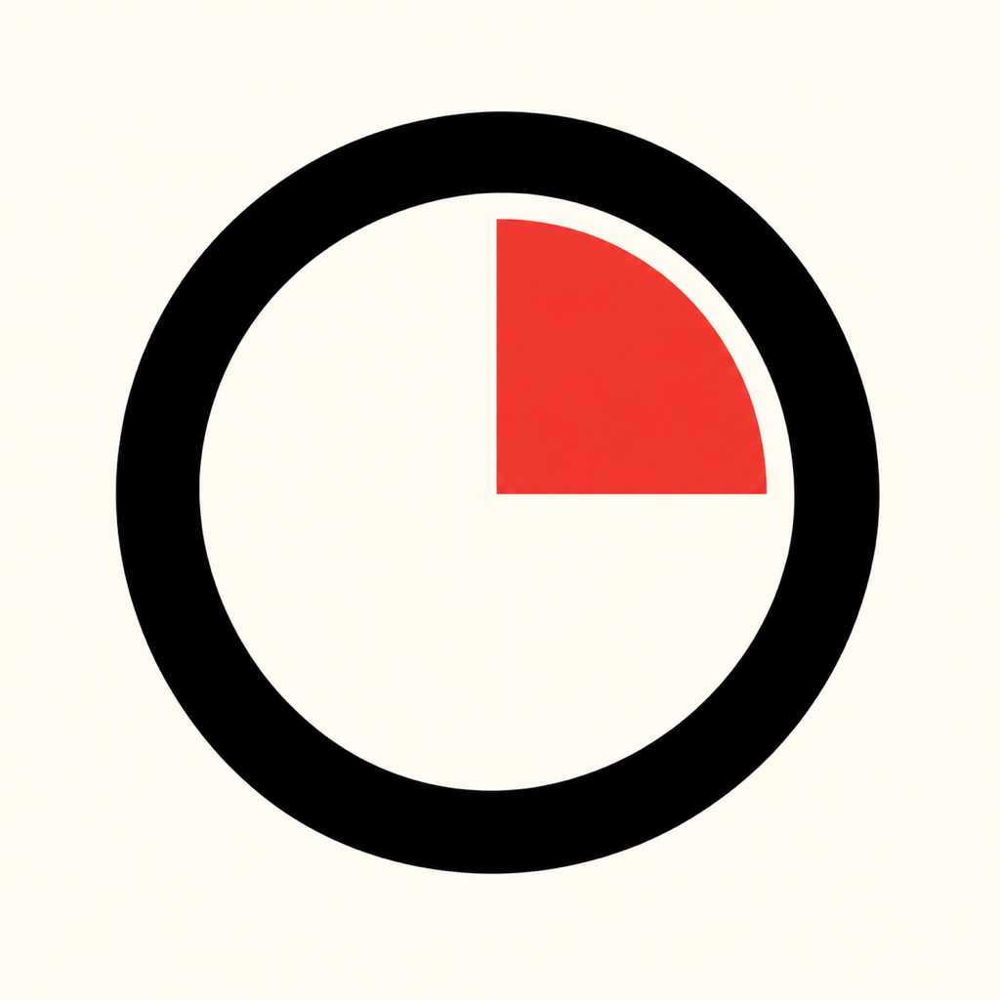
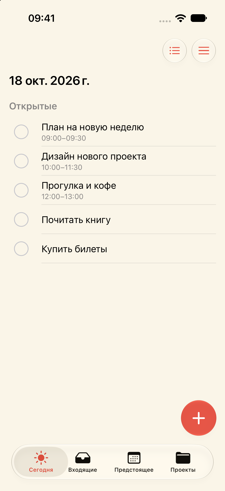
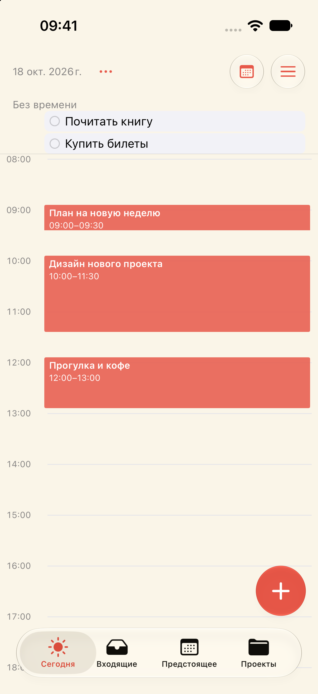

<div align="center">
  

  <h1>Orbit</h1>
  <p><strong>Задачи и время — в одном месте.</strong></p>
  <p>Локальный планировщик для iPhone со списками, проектами и календарём.</p>
  <p><code>SwiftUI</code> · <code>SwiftData</code> · <code>Local-first</code> · <code>iOS 17+</code></p>
  <p>
    <a href="#возможности">Возможности</a> ·
    <a href="#календарь">Календарь</a> ·
    <a href="#запуск">Запуск</a> ·
    <a href="#разработка">Разработка</a> ·
    <a href="#дальше">Дальше</a>
  </p>
</div>

---

Orbit помогает собрать дела во «Входящих», распределить их по проектам и найти для них время. Можно вести обычный список, планировать день на временной шкале или смотреть вперёд через повестку и календарь месяца.

**Без регистрации и сервера.** Задачи хранятся на устройстве и доступны между запусками приложения.

> **В разработке · 23 октября 2026**<br>
> Локальный iOS-планировщик с пятью видами планирования, проектами и выбором из 12 иконок. Накопленные исправления оформления, календаря и форм установлены и запущены на iPhone 23 октября; пользователь подтвердил работу переноса между сеткой и «Без времени». Публикации в App Store пока нет.

## Приложение

<table>
  <tr>
    <th width="50%">Планы на день</th>
    <th width="50%">Время для важных дел</th>
  </tr>
  <tr>
    <td align="center"></td>
    <td align="center"></td>
  </tr>
  <tr>
    <td align="center">Всё нужное — в одном списке.</td>
    <td align="center">Планируйте задачи прямо на шкале времени.</td>
  </tr>
</table>

<sub>Реальные экраны приложения · iPhone 17 Simulator · тема «Слоновая кость» · демонстрационные задачи.</sub>

## Возможности

| Раздел | Для чего |
| :--- | :--- |
| **Сегодня** | Список дел текущего дня или календарь с временной шкалой. |
| **Входящие** | Общий список задач, включая дела без даты. |
| **Предстоящее** | Планирование на выбранную дату: **Список · Повестка · Календарь · 3 дня · Месяц**. |
| **Проекты** | Папки задач со своими видами «Список» и «Календарь». Создание, переименование и назначение проекта задаче. |

Выбранный вид сохраняется отдельно для «Сегодня», «Предстоящего» и каждой папки проекта. Все представления используют одни и те же задачи.

### Единое оформление

Подписанный выбор вида, одно меню действий и общая иерархия задач во всех разделах. Календарь использует нейтральные карточки с цветной границей; коралл выделяет действие и выбор. У каждой формы есть закреплённые «Отмена» и «Сохранить/Добавить».

[Правила интерфейса](DESIGN.md) · [Исходный аудит](docs/design-audit/README.md) · [Реализация и проверки](reports/DESIGN-UNIFY/README.md). Снимки в разделе «Приложение» относятся к предыдущему оформлению; новые контрольные экраны находятся в отчёте.

### От идеи к задаче

Нажмите **«+»** — название и основные параметры находятся в компактной форме, а дедлайн и напоминание раскрываются через **«Дополнительно»**. Кнопки «Отмена» и «Добавить» доступны и с открытой клавиатурой.

- **Дата необязательна.** Во «Входящих» форма открывается без даты; в «Сегодня» и «Предстоящем» подставляется текущий или выбранный день.
- **Проект подставляется**, если задача создаётся внутри его папки.
- **Время и длительность — пара.** Удаление даты убирает и временной интервал. Начало выбирается с точностью до минуты; колесо длительности — от 5 минут до 24 часов с шагом 5 минут.
- **Через полночь тоже можно.** Конец рассчитывается автоматически, продолжение показывается в следующем дне.
- **Запись только по подтверждению.** Отмена и закрытие формы не создают задачу.

Короткое нажатие на задачу открывает карточку с действиями: выполнить или вернуть в работу, изменить дату, время, проект, дедлайн и напоминание, переименовать либо удалить с подтверждением.

### Просроченные и массовые действия

Раскрываемый блок **«Просрочено»** доступен в основных разделах и папках проектов. Он собирает незавершённые задачи с прошедшей датой планирования; в проекте — только его задачи. Прошедшая дата выделяется красным.

В меню **⋯ → Выбрать** можно отмечать задачи нажатием на всю строку. Круг заполняется красным, а вкладки плавно сменяются нижней панелью: **перенести · завершить · удалить**. Перенос на другую дату сохраняет остальные параметры задачи.

## Календарь

### Один день

Временная шкала **00:00–24:00**, соседние колонки для пересекающихся задач и компактная область **«Без времени»** над сеткой.

| Жест | Действие |
| :--- | :--- |
| Короткий тап по задаче | Открыть карточку и меню действий. |
| Удержание и перенос | Переместить задачу по времени, сохранив длительность. Шаг — 5 минут. |
| Верхняя правая точка | Изменить начало задачи. |
| Нижняя левая точка | Изменить конец. Длительность меняется по 10 минут, минимум — 5 минут. |
| Тап по свободному месту | Снять выделение. |
| Удержание пустой сетки | Наметить интервал и открыть форму создания после отпускания. |

У краёв сетки работает автопрокрутка при переносе, изменении размера и создании. В календаре дня задачу можно перенести из «Без времени» на сетку и обратно; возврат убирает время, сохраняя дату. При изменении временного шага предусмотрены тактильные постукивания.

Черновик на сетке остаётся видимым при переходе к форме. Перенос и изменение размера сохраняются при отпускании, создание — после нажатия «Добавить».

### Три дня

Три соседние даты на **общей временной шкале** с единой вертикальной прокруткой. Стрелки переключают окно по три дня, а нажатие на заголовок выбирает дату для «+».

Задачи можно переносить **между колонками**, менять их начало и конец или создавать удержанием в нужном дне. Дата и интервал переносятся одной операцией.

В области «Без времени» сначала видно до **трёх** задач. Красные стрелки раскрывают до **семи**; прокрутка появляется, только если задач больше. Перенос из этой области на сетку и обратно в трёхдневном виде пока не добавлен.

### Месяц

Сетка с понедельника, **точки на датах с задачами** и список выбранного дня под календарём. Нажмите день, чтобы увидеть его дела; «+» создаст задачу на эту дату.

Стрелки листают месяцы, заголовок открывает выбор месяца и года в диапазоне **1900–2199**. Просмотр другого месяца не меняет выбранную дату до нажатия на день.

### Повестка

Последовательность дней с задачами и кнопками быстрого добавления. Верхняя недельная шапка связана с прокруткой: верхний видимый день выделяется, выбор даты прокручивает к ней, переключение недели — к её началу.

Прошлый день можно открыть через календарь. Когда он полностью уходит вверх при прокрутке вперёд, обратная прокрутка к нему закрывается; явно выбрать его снова можно.

## Дедлайны и напоминания

**Дедлайн** — отдельный срок до конца дня. Он не двигает задачу на временной шкале и сам по себе не создаёт уведомление. Незавершённая задача получает отметку просроченного срока со следующего дня.

**Напоминание** — один необязательный момент уведомления, независимый от даты планирования и дедлайна. При включении напоминания для задачи со временем предлагается момент за **10 минут до начала**. При переносе задачи уже заданный момент напоминания сохраняется. Время ввода отображается в текущем часовом поясе.

Разрешение на уведомления запрашивается при их явном включении. Завершение или удаление задачи отменяет уведомление; возврат в работу восстанавливает только будущее напоминание. Ошибку системной очереди можно повторно проверить, сама задача остаётся сохранённой.

В **Настройки → Уведомления → Звук** доступны стандартный звук, тишина, «Колокольчик», «Капля» и «Сигнал» с прослушиванием. Звук общий для всех задач; его смена обновляет назначенные напоминания.

<details>
<summary><strong>Ограничения уведомлений</strong></summary>

Очередь содержит ближайшие 64 запроса с учётом других уведомлений приложения. Для пополнения более длинной очереди потребуется снова открыть Orbit. Системные настройки и Фокусирование могут отключать показ или звук. Реальная доставка при закрытом процессе подтверждена на собственном Simulator; это не заменяет проверку на физическом iPhone.

</details>

## Оформление

Пять вариантов: **как на устройстве · светлая · слоновая кость · тёмная · чёрная OLED**. Для системного режима можно выбрать свою светлую и тёмную пару. Тема применяется после предпросмотра.

В настройках также доступны **12 иконок**: три фона и четыре акцента. Иконка выбирается независимо от темы интерфейса. Общий переключатель управляет виброоткликом. Выполнение задачи сопровождается звуком и тактильным откликом.

На iOS 26+ используются системные стеклянные элементы; для более ранних версий предусмотрено альтернативное оформление.

## Запуск

Нужны **macOS, Xcode, iOS SDK и Simulator runtime**. Для native-приложения не требуются Node.js, PostgreSQL или `.env`.

```sh
export DEVELOPER_DIR=/Applications/Xcode.app/Contents/Developer
open apple/OrbitIOS/OrbitIOS.xcodeproj
```

В Xcode выберите схему **OrbitIOS**, iPhone Simulator и нажмите **Run**.

<details>
<summary><strong>Сборка из терминала и установка на iPhone</strong></summary>

Из корня репозитория:

```sh
export DEVELOPER_DIR=/Applications/Xcode.app/Contents/Developer
xcodebuild \
  -project apple/OrbitIOS/OrbitIOS.xcodeproj \
  -scheme OrbitIOS \
  -sdk iphonesimulator \
  -destination 'generic/platform=iOS Simulator' \
  -derivedDataPath /tmp/orbit-ios-build \
  CODE_SIGNING_ALLOWED=NO build
```

Для своего iPhone настройте Apple ID, Development Team и provisioning в Xcode. Персональные сертификаты и профили в репозиторий не входят. Сборка Simulator без подписи не устанавливает приложение на телефон.

В проекте указан минимум **iOS 17**; текущие сборки проверялись с **Xcode 27 / iOS 27 Simulator**. Проверка каждой поддерживаемой версии iOS отдельно ещё не выполнена.

Подробнее: [iOS-разработка](apple/OrbitIOS/README.md).

</details>

## Разработка

Native-приложение написано на **Swift / SwiftUI / SwiftData**. Общий пакет `OrbitCore` не зависит от UIKit или AppKit.

```text
apple/
├── Orbit/
│   ├── Sources/OrbitCore/    Модель, хранилище, даты и календарные расчёты
│   └── Tests/OrbitCoreTests/ Тесты ядра и сохранения данных
└── OrbitIOS/
    ├── OrbitIOS.xcodeproj    iPhone-приложение, схема OrbitIOS
    └── OrbitIOS/            Экраны, формы, темы и жесты
reports/                     Результаты проверок и ограничения
tasks/                       Задания по этапам
```

### Проверки

```sh
export DEVELOPER_DIR=/Applications/Xcode.app/Contents/Developer
cd apple/Orbit
swift test
```

После разделения платформ: **126 тестов ядра, 16 suites — PASS**, сборка iOS — PASS. Пять macOS CLI-проверок вынесены вместе с macOS-клиентом. [Отчёт разделения](reports/IOS-REPO-SPLIT.md).

Для «Месяца» прошли сборки Simulator и iPhone, проверка выбора дня, отметок, создания и отмены, перехода между месяцами и сохранения вида после перезапуска на собственном Simulator. Обновление установлено на iPhone поверх существующего приложения.

Последняя проверка ядра: **126 тестов в 16 suites — PASS**. Сборки Simulator и подписанная сборка iPhone прошли. На узком Simulator проверены крупный шрифт, массовый выбор, светлые темы, формы, сохранение и отмена напоминания. Проверочная ошибка создания не сбрасывает черновик; форма прокручивается к сообщению ошибки.

Физическая установка и запуск подтверждены; перенос в сетку и обратно подтверждён пользователем. Это не полный проход всех устройств и тем. VoiceOver исключён из текущего этапа по запросу пользователя. Реальная ошибка диска не воспроизводилась: сохранность черновика проверялась с временной подменой ошибки, удалённой из итогового кода. [Последние проверки](reports/README.md).

### Данные

- SwiftData-база iOS: `Library/Application Support/Orbit/store.sqlite` внутри sandbox приложения.
- Аккаунты, серверная синхронизация и CloudKit в native-приложении не используются.
- Дата планирования — Gregorian civil-значение `YYYY-MM-DD`, диапазон 1900–2199. Конец интервала вычисляется.
- Ошибка открытия базы показывается явно, без удаления файла или подмены пустой базой.
- Старые интервалы в 1–4 минуты остаются читаемыми; новая запись требует минимум 5 минут.

**Для сохранения локальных задач обновляйте приложение поверх установленного.** Пользовательский экспорт и восстановление пока не реализованы. В разработке используйте собственный Simulator или временное хранилище.

### Репозитории Orbit

- **Orbit iOS** — этот репозиторий: iPhone-приложение, Swift-ядро, тесты и ресурсы.
- **[Orbit-Web](https://github.com/KrakeKrip/Orbit-Web)** — Next.js, серверная часть, миграции и веб-тесты.
- **Orbit-MacOs** — отдельный репозиторий будет создан позже. macOS-клиент не входит в iOS-проект.

## Дальше

- Теги и приоритеты задач.
- Доски проектов и управление удалением проектов.
- Доводка календарных жестов на физических устройствах.
- Экспорт и восстановление данных.
- AI-ввод и синхронизация — последующие этапы.

Это направления развития, а не обещанные сроки выпуска.

---

[Требования](PRODUCT.md) · [Архитектура](ARCHITECTURE.md) · [Дизайн](DESIGN.md) · [Задачи](TASKS.md) · [Решения](DECISIONS.md) · [Отчёты](reports/README.md)
