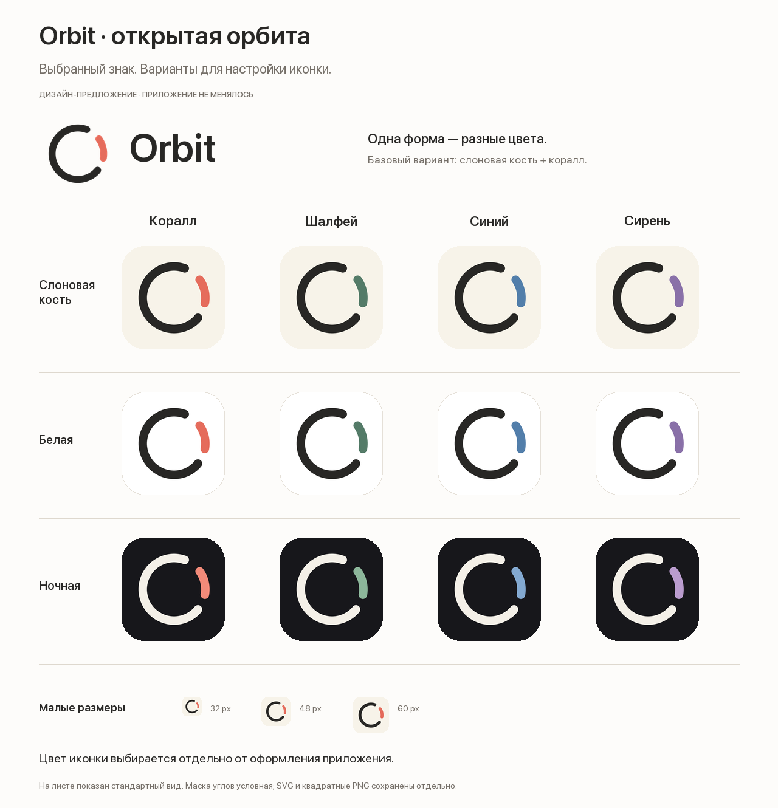
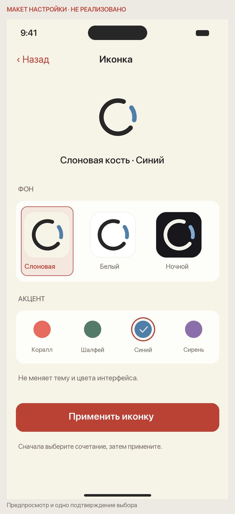

# Orbit · открытая орбита · выбранное направление

22 октября 2026. Пользователь выбрал первый вариант и поддержал подготовку цветовых вариантов. Это следующий раунд дизайна; установка новой иконки и реализация настройки ещё не выполнялись.

## Знак и палитра

Сохранены круговая геометрия, характер разрывов, округлённые окончания и относительный вес выбранного знака. В этой версии внесён небольшой оптический сдвиг всей геометрии вправо на 4 единицы из 512 (0,78% ширины). Дуги не перестраивались в новое направление. Исходный одобренный эскиз сохранён в родительском каталоге.

Основное сочетание: **слоновая кость + графит + коралл**.

| Параметр | Варианты |
|---|---|
| Фон | Слоновая кость, белый, ночной |
| Дуга | Коралл, шалфей, синий, сирень |
| Кольцо | Графит на светлых фонах, светлая слоновая кость на ночном |
| Всего | 12 подготовленных стандартных цветовых сочетаний |

Коралл остаётся основным фирменным акцентом. Остальные цвета — персонализация иконки, они не становятся новыми темами приложения. Геометрия одинакова во всех сочетаниях.

## Предложение настройки

Настройки → **Иконка приложения** → предпросмотр и два параметра: **Фон** и **Акцент**.

- Текущее установленное сочетание показано при открытии. Выбор на экране меняет локальный предпросмотр.
- «Применить иконку» выполняет один запрос для выбранного сочетания. Это позволяет перебрать цвета без системной смены на каждом касании.
- Возврат без применения ничего не меняет. Для уже установленного сочетания кнопка неактивна.
- Выбранное состояние определяется не одним цветом: у фона рамка, у акцента рамка и галочка, у контролов доступные подписи.
- При успехе показывается фактически установленный вариант. При ошибке прежняя иконка и draft сохраняются, рядом короткая ошибка; успешное состояние не выставляется заранее.
- Выбор иконки независим от `orbit.ui.appearance` и не меняет тему, цвет кнопок, данные задач или проекты.
- Нативный navigation/form и расположение на небольшом экране уточняются при реализации. Макет 390 pt — визуальное предложение, не проверка Dynamic Type и не рабочий SwiftUI-экран.

## Как это предполагается реализовать в iOS

Заранее подготовленные альтернативные иконки включаются в приложение. Настройка сопоставляет сочетание с конкретным asset, затем использует `UIApplication.setAlternateIconName`. Основной вариант возвращается через `nil`; перед запросом проверяется `supportsAlternateIcons`, после успеха UI сверяется с `alternateIconName`. Ошибку обрабатывают без ложного изменения выбранного состояния. Это соответствует [документации Apple API](https://developer.apple.com/documentation/uikit/uiapplication/setalternateiconname(_:completionhandler:)) и [руководству настройки альтернативных иконок](https://developer.apple.com/documentation/xcode/configuring-your-app-to-use-alternate-app-icons).

Здесь предлагается выбор готовой палитры, а не произвольный RGB-picker. Подготовлено 12 статических стандартных вариантов, **они ещё не являются production asset catalog**. Перед интеграцией необходимо подготовить и проверить предусмотренные целевым SDK dark/clear/tinted appearances каждого альтернативного набора. Системное оформление домашнего экрана может менять итоговое представление; его не следует смешивать с темой самого Orbit. Требования к этим appearances описаны в [Apple HIG: App icons](https://developer.apple.com/design/human-interface-guidelines/app-icons).

## Материалы

- [Интерактивное локальное превью](preview.html): фон/акцент и примеры 32/48/60 CSS px. Оно меняет только картинку, не системную иконку.
- [Цветовой лист](icon-colours.png) и [макет настройки](settings-proposal.png).
- [manifest.json](manifest.json): все 12 сочетаний, цвета и пути файлов.
- [Основной прозрачный SVG](assets/mark.svg), [светлый SVG для тёмного фона](assets/mark-inverse.svg), [монохром](assets/mark-mono.svg).
- [Связка со словом Orbit](assets/wordmark.svg): системный SF/Helvetica/Arial, редактируемый текст, не финальный lettering и без встроенного шрифта.
- [Основная иконка 1024 PNG](assets/ivory-coral-1024.png), [основная иконка SVG](assets/ivory-coral.svg). Все сочетания — в [assets/](assets/).
- [render.py](render.py): воспроизводимая генерация геометрии и макетов.

PNG иконок 1024×1024 — RGB, непрозрачные и квадратные, без заранее нарисованных скруглений. У прозрачных master PNG фон отсутствует намеренно: это знак для других носителей, не готовая app icon. Скругления на листе и HTML — условная маска превью.

Проверено: синтаксис всех SVG, размеры/режим PNG, полнота manifest, визуальная компоновка обоих листов. На реальном домашнем экране Simulator, с системным tint/clear, другими обоями, VoiceOver и Dynamic Type эта настройка ещё не проверялась, поскольку приложение не менялось. Уменьшенные картинки на общем листе масштабируются вместе с ним; размеры 32/48/60 CSS px проверять в HTML при масштабе браузера 100%.
