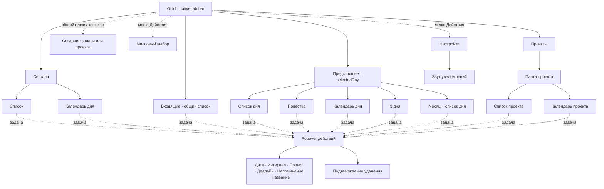

# Карта экранов, состояний и сценариев

## Обозначения и границы

**V** — пройдено/увидено в текущем Simulator. **C** — проверено только по актуальному коду. **P** — частичный GUI-проход. **—** — не проверено. Пустая клетка не означает отсутствие функции или бага. Все визуальные captures имеют отдельные ссылки в [каталоге](screenshots/README.md).

Основной проход — iPhone 17 / iOS 27.0, обычный размер текста, тема «Слоновая кость». Системное светлое оформление наблюдалось при первом запуске; light/dark/OLED проверены на экране настроек. Матрица каждой формы во всех пяти темах не пройдена.

## Карта продукта

Схема показывает существующие семейства, а не новый navigation flow. «Проекты» создают проект, а внутри папки «+» создаёт задачу. Глобальное меню имеет контекстные ограничения.

## Экраны и представления

| Экран | GUI | Проверенные состояния | Доказательство / локальный источник | Что осталось |
|---|---|---|---|---|
| Сегодня, список | V | Пусто, 10 задач, длинное имя, переход к меню, bulk, completed, AX XXXL | 03, 06, 07, 18, 22; `TodayScreen` | Все-completed, 500 символов, полный scroll большой выборки |
| Сегодня, день | V/P | Untimed3/раскрытие, 2 одинаковых пересекающихся интервала, scroll с карты/свободного места, пустой следующий день | 09, 17; `CalendarDayScreen`, `DayTimelineView` | Полный move/resize, короткие 5мин и 3+ overlap, autoscroll, midnight segment |
| Входящие | V | Общий датированный список, undated project task, overdue раскрыт, меню | 16; `InboxScreen` | Пустое состояние прочитано C, не снято отдельно; полноценный mixed-date stress |
| Предстоящее, список | V | Выбранный день, date controls, те же задачи | 05; `UpcomingListScreen` | Горизонтальное листание и смена Today-button в GUI отдельно не зафиксированы |
| Предстоящее, повестка | V/P | Недельная шапка, наполненный день, будущие пустые секции, локальные «+» видны | 10; `UpcomingAgendaScreen` | Длинный scroll-sync и past boundary после ухода прошлой даты |
| Предстоящее, день | C | Общий компонент дня + browsingDay, swipe ±1 | `UpcomingWorkspaceScreen`, `CalendarDayScreen` | Отдельный полный GUI-проход этого контекста |
| Предстоящее, 3 дня | V/P | 3 колонки, overlap, untimed, удержание/ручки, AX XXXL | 11, 23; `ThreeDayCalendarScreen` и diff891ac15 | Межколоночный move, resize, autoScroll не подтверждены |
| Предстоящее, месяц | V/P | Месячная сетка, точки, выбор прошлого дня, список и создание на выбранную дату | 12; `UpcomingMonthScreen`, `MarkedMonthCalendar` | Browse другого месяца vs selectedDay, jump-year picker, границы1900/2199 |
| Проекты, индекс | V/P | Пустой экран, создание и список с длинным именем | 15; `ProjectsScreen` | Большое число проектов, context rename проекта — C |
| Папка проекта, список | V | Длинный заголовок, пустое состояние, создание task с project preset и nil date | `ProjectWorkspaceScreen` | Filled folder визуально не снята отдельно; проектная строка была видна в общих данных |
| Папка проекта, день | C | Фильтр projectID, выбранный день, общий календарь | `ProjectWorkspaceScreen`, `CalendarDayScreen` | Весь GUI-сценарий в этом контексте |
| Общий selection | V/P | Выбрать2, счётчик, tabs→actions, подтверждение delete и отмена снаружи, complete2 | 18; `OrbitTaskSelectionHeader` | Selection в календарях/agenda, ошибка bulk save |
| Просроченные | V/P | Разворачивание, metadata, перенос всех11 на сегодня после смены даты | 17; `OverdueTaskBlock` | Ограничение230 pt на большой AX-выборке и проектный scope GUI |

## Формы и меню

| Поверхность | GUI | Что сделано | Ограничения |
|---|---|---|---|
| Создание задачи | V | Длинное имя, клавиатура, time toggle, duration wheel, add, дополнительные поля видны | Invalid duration и clear-date chain — C; 04 |
| Создание из Входящих | C | Nil preset | GUI-проверено nil создание в проектном списке через ту же форму |
| Создание в проекте | V | Project preset, nil date, save | Дальнейший перенос проекта не выполнялся |
| Создание на выбранный день месяца | V | 20 октября, синтетическая overdue task | Дата выбора в месяце сохранена до открытия |
| Создание на375pt | V | Ввод, открытая keyboard, Add/Cancel видимы, Cancel | 28; заполненный календарь на mini не проверялся |
| Task popover | V | 8 действий, длинный preview, outside dismiss, переход к редакторам | 07; высота near-bottom/AX popover — C |
| Дата задачи | V/P | Medium открытие, раскрытие до large, Cancel | Кнопки вне первого viewport, 08; изменения wheels не сохранялись |
| Интервал | V/P | Открыть, раскрыть начало, collapsed duration, Cancel | 24; программный setValue wheel через CUA не изменил значение, запись интервала не подтверждена |
| Дедлайн | V | Выбрать текущий срок, Save | 13; получен deadline21Oct, затем просрочен после полуночи |
| Напоминание | V | Включение, системный prompt, Don’t Allow, Save | 14; фактическая доставка не проверена |
| Проект задачи | V/P | Открыт список выбора, длинный проект виден, Cancel | 26; assignment не сохранялся |
| Название задачи | V | Пустой/пробельный ввод, ошибка, клавиатура, Cancel | 25; корректное переименование не сохранялось, исходное имя осталось |
| Удаление задачи | V/P | Нативный диалог, полное длинное имя, outside dismiss | 27; необратимое удаление не выполнялось |
| Создать проект | V | Длинное название, keyboard, Save | 15;120+ и пустое имя — C |
| Переименовать проект | C | Тот же `ProjectNameSheet`, context menu | Отдельный GUI-проход не сделан |
| Массовый перенос | V/C | Quick «На сегодня» выполнен; date sheet просмотрена по коду | Picker save и Cancel GUI не пройдены |
| Настройки | V | Все5 пунктов appearance, permission-state, sound и feedback switches | 01,19–21; не каждый экран в каждой теме |
| Выбор звука | V/P | Список, selected state, отдельные preview buttons | 02; прослушивание и качество звука не подтверждены |

## Сценарии взаимодействия

| Сценарий | Результат / основание |
|---|---|
| Tap title → menu → editor | **V:** работает для основных list-task действий |
| Tap completion | **V:** completion controls видны и отдельны; подтверждено сохранённое массовое завершение2 |
| Hold calendar | **V:** в «3 дня» появилось выделение с ручками |
| Scroll с timed task | **V:** сетка прокрутилась без изменения 09:00–09:30 в891ac15 |
| Scroll со свободной сетки | **V/P:** видимая область сетки менялась; точное отсутствие всех конфликтов recognizer не доказано |
| Move / cross-column | **P:** CUA hold и следующий отдельный drag не образовали надёжный непрерывный gesture; задача не перенеслась. Не классифицировано как bug |
| Resize start/end | **C:** ручки, thresholds и сохранение прочитаны; нет подтверждённого GUI изменения |
| Untimed → grid → untimed | **C:** реализовано для дня; «3 дня» не поддерживает этот перенос по текущему контракту |
| Hold empty → create preview → Cancel | **C:** ветки кода просмотрены, полный GUI не выполнен |
| AutoScroll | **C:** обработчики edge tick и viewport прочитаны; реальная непрерывная манипуляция не подтверждена |
| Cancel task create/editor | **V:** закрытие/отмена не создали лишних тестовых задач; специально отменён mini draft и rename draft |
| Delete cancel | **V:** outside dismiss сохранил задачу; удаления не было |
| Persist after restart | **V/P:** синтетические задачи и тема сохранились после shutdown/relaunch. Это не upgrade/migration test |
| Смена суток | **V:** после естественного наступления22Oct и relaunch Today новый день, вчерашние11 задач в overdue; live timer00:00 — **C**, не V |
| Независимые deadline/reminder | **V:** bulk перенос на22Oct сохранил deadline21Oct и reminder21Oct23:43 |
| Error save/store-open | **C:** UI и safe store-open изучены; дисковые отказы/повреждение не индуцировались |
| Validation error | **V:** пробельное имя при rename показывает ошибку, draft остаётся |
| Haptics / sound | **C:** вызовы и выключатели есть. Simulator/build не подтверждают физический эффект |

## Темы и доступность

| Проверка | Статус |
|---|---|
| System light | **V:** начальный пустой Today и mini form |
| System follow light→dark в активном приложении | **—** |
| Light / Ivory / Dark / OLED settings | **V:** captures01,19,20,21; все пункты выбраны/осмотрены |
| Полная theme matrix всех календарей и форм | **—**, риски найдены по color source |
| Contrast | **C:** воспроизводимый расчёт исходных sRGB-пар; реальные UI-композитные пары систематически не измерены |
| Dynamic Type maximum, list | **V:** перенос растёт, completion остаётся маленьким и по центру высокой строки,22 |
| Dynamic Type maximum, 3days | **V:** обрезанные dates/untimed и мелкий timed text,23 |
| Остальные AX sizes / все формы | **—** |
| VoiceOver | **C/P:** labels/hints и CUA tree осмотрены; полноценный VoiceOver focus/rotor/activate сценарий **не выполнен** |
| Reduce Motion | **C:** явные ветки просмотрены; GUI-setting и сравнение анимаций **не выполнены** |
| Increase Contrast / Reduce Transparency | **—** |
| Маленький экран375pt | **V/P:** emptyToday, create+keyboard+cancel наiPhone13mini; не весь продукт |
| Физический iPhone | **—**, не устанавливалось и не читалось |
| iOS17–26 | **—**, только code fallback review; runtime27 — единственный GUI |

## Следующий целевой QA-проход перед реализацией жестов

На собственном fixture добавить: 5мин, 15мин, несколько перекрывающихся задач,3 одинаковых названия,500Unicode scalars, midnight23:45–00:15, весь день1440мин, много untimed, completed/overdue/deadline/reminder в одной задаче. Проверить полную матрицу touch→hold→move→autoscroll→release/cancel, обе ручки и соседние границы. Отдельно пройти VoiceOver от вкладки до изменения времени и назад, Reduce Motion, theme transitions и мини-экран. Эти сценарии — оставшийся долг проверки, а не уже подтверждённые возможности.
