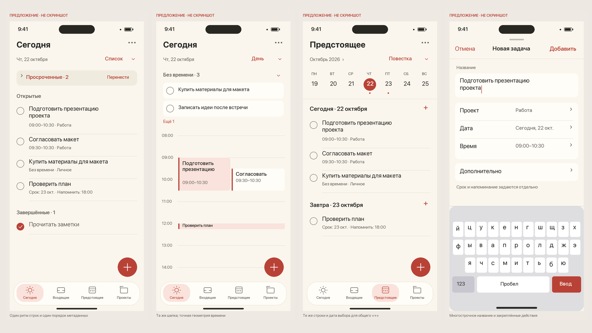

# Предложение единого интерфейса

**Это макеты, не скриншоты текущего Orbit и не реализованный редизайн.** Синтетическое содержимое иллюстрирует правила. Системное стекло, клавиатура, иконки и tab bar показаны схематически. Размер экрана макета 390 × 844 pt, PNG в 3×; 375 pt и Dynamic Type потребуют адаптивного SwiftUI, а не масштабирования картинки.

## Сегодня — список

[Полный макет](today-list.png)

Название раздела занимает стабильное место; дата вторична. Меню видов содержит текст текущего вида. Существующее меню действий обозначено многоточием. Просроченные остаются раскрываемой строкой. Время и проект читаются в одном порядке, срок и напоминание — с явными словами. Тонкая линия выровнена по заголовку задачи. Высота строки определяется содержимым, круг выполнения привязан к первой строке. Отдельные карточки для каждой задачи не нужны.

## Сегодня — календарь дня

[Полный макет](today-day.png)

Та же шапка и те же поверхности. У задач без времени удобная строка 44 pt. Календарные интервалы сохраняют точную временную геометрию: высота определяется длительностью, пересечение — колонками. Вместо белого мелкого текста на ярком красном — тёмный текст на светлой поверхности и коралловая кромка. Не выбранные задачи не получают разную насыщенность без причины. Макет показывает один допустимый вариант фона; не следует трактовать оттенок как проект, приоритет или новый статус.

Для короткого блока показывается только название; полный интервал доступен в существующем меню. Нельзя увеличивать высоту пяти минут до 44 pt и тем самым искажать время. Нужен отдельный безопасный способ попадания в короткую задачу, описанный в дизайн-системе.

## Предстоящее — повестка

[Полный макет](upcoming-agenda.png)

Строки совпадают со списком. Недельная полоса остаётся локальным средством навигации; день в заголовке секции задаёт контекст для существующего маленького «+». Общий «+» использует видимую выбранную дату. На будущих датах рядом с диапазоном появляется существующий возврат «Сегодня» в одном фиксированном месте. На показанном экране дата уже сегодняшняя, поэтому возврат не нужен.

## Создание задачи

[Полный макет](create-task.png)

Единая верхняя панель «Отмена — заголовок — Добавить», многострочное название, спокойные группы полей. Проект, дата, время используют одинаковую строку «название — значение — раскрытие». «Время» здесь показывает существующий интервал; при раскрытии остаются начало, длительность и вычисляемый конец. Выбор «Без времени» соответствует существующему удалению интервала. Эти действия не требуют новой модели данных.

«Дополнительно» сохраняет дедлайн и напоминание; уже заданные значения должны быть видны в свёрнутом summary. Клавиатура ограничивает область прокрутки, а не сдвигает основные действия за экран. Схема ниже клавиатуры не претендует на дизайн системной клавиатуры.

## Что макеты не добавляют

Новые вкладки, приоритеты, теги, поиск, недельный режим, синхронизацию, аналитику, экспорт, автоматическое изменение напоминания и новую карточку деталей. Предложение переорганизует существующие элементы. Порог плотности, вид строк, шапка и цвета — дизайнерские решения для обсуждения. Их проверка на собственном Simulator должна предшествовать распространению на все виды.
