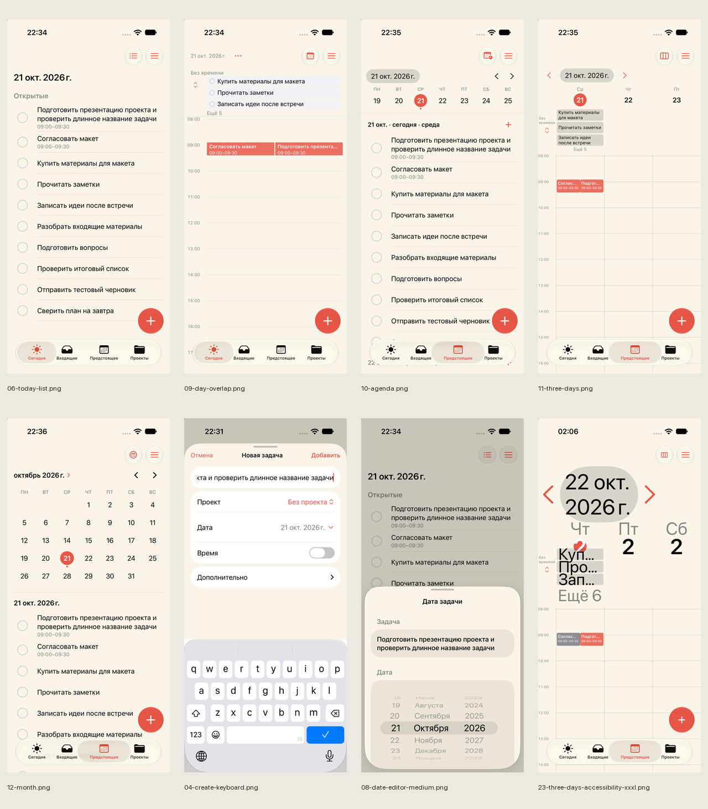

# Реальные скриншоты

Все оригиналы — новая сборка `891ac15`, собственные Simulator, синтетические данные. Это текущий интерфейс; предложения находятся в соседнем каталоге `proposals/`. 01–16 сняты 21 октября 2026; 17–28 — 22 октября. Основной аппарат — iPhone 17, снимок 28 — iPhone 13 mini. Runtime iOS 27.0.

| № | Экран / состояние | Файл |
|---|---|---|
| 01 | Настройки, слоновая кость, уведомления ещё не запрошены | [Оригинал](01-settings-ivory.png) |
| 02 | Выбор звука | [Оригинал](02-sound.png) |
| 03 | Сегодня, пустой список | [Оригинал](03-today-empty.png) |
| 04 | Создание, длинное название, клавиатура | [Оригинал](04-create-keyboard.png) |
| 05 | Предстоящее, список одного дня | [Оригинал](05-upcoming-list.png) |
| 06 | Сегодня, 10 задач | [Оригинал](06-today-list.png) |
| 07 | Карточка и восемь действий задачи | [Оригинал](07-task-actions.png) |
| 08 | Дата, medium sheet, основные действия ниже области просмотра | [Оригинал](08-date-editor-medium.png) |
| 09 | День: пересечение 09:00–09:30, свёрнуто «Без времени» | [Оригинал](09-day-overlap.png) |
| 10 | Повестка с наполненным днём | [Оригинал](10-agenda.png) |
| 11 | Три дня: пересечение и задачи без времени | [Оригинал](11-three-days.png) |
| 12 | Месяц и список выбранного дня | [Оригинал](12-month.png) |
| 13 | Дедлайн, два уровня подтверждения | [Оригинал](13-deadline.png) |
| 14 | Напоминание после отказа в системном разрешении | [Оригинал](14-reminder-denied.png) |
| 15 | Новый проект с длинным названием и клавиатурой | [Оригинал](15-project-create.png) |
| 16 | Входящие с датированными задачами и блоком просроченных | [Оригинал](16-inbox.png) |
| 17 | Сегодня после смены даты и перезапуска, 11 просроченных | [Оригинал](17-next-day-relaunch.png) |
| 18 | Две выбранные задачи, панель массовых действий | [Оригинал](18-bulk-selection.png) |
| 19 | Настройки, тёмная тема | [Оригинал](19-settings-dark.png) |
| 20 | Настройки, чёрная OLED | [Оригинал](20-settings-oled.png) |
| 21 | Настройки, светлая тема | [Оригинал](21-settings-light.png) |
| 22 | Сегодня, максимальный Dynamic Type | [Оригинал](22-today-accessibility-xxxl.png) |
| 23 | Три дня, максимальный Dynamic Type, обрезания | [Оригинал](23-three-days-accessibility-xxxl.png) |
| 24 | Редактор времени, группы свёрнуты | [Оригинал](24-interval.png) |
| 25 | Переименование, пустой ввод, ошибка и клавиатура | [Оригинал](25-rename-validation.png) |
| 26 | Выбор проекта задачи | [Оригинал](26-task-project.png) |
| 27 | Подтверждение удаления с длинным названием, удаление не выполнено | [Оригинал](27-delete-confirmation.png) |
| 28 | Маленький iPhone 13 mini: форма с клавиатурой | [Оригинал](28-mini-create-keyboard.png) |

