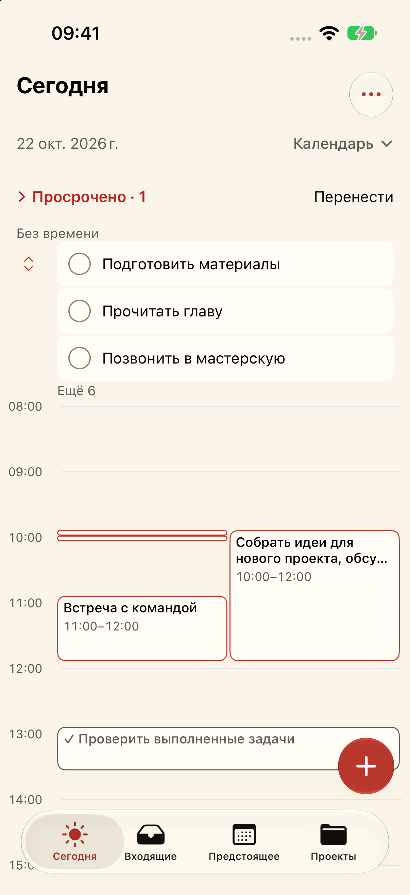
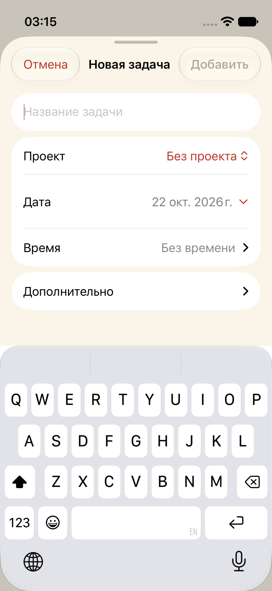
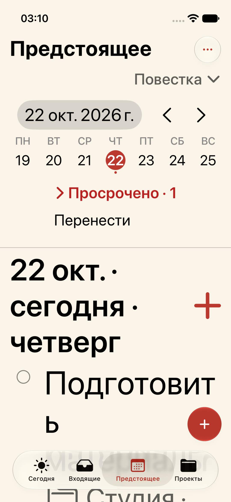
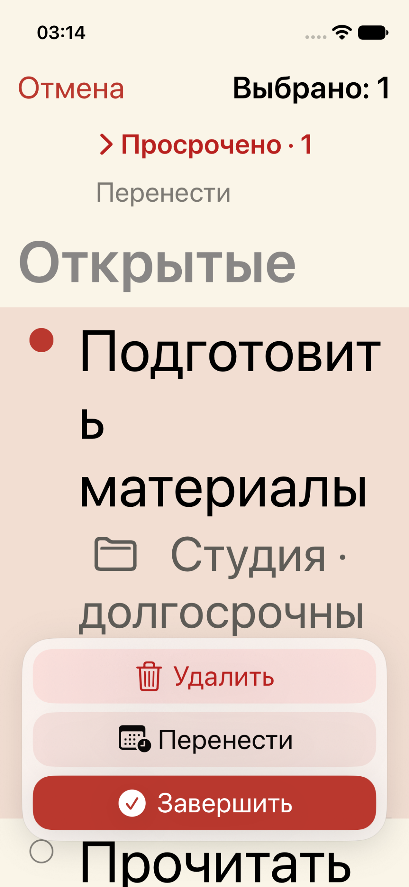

# DESIGN-UNIFY — реализация дизайн-аудита

22 октября 2026. Ветка `task/DESIGN-UNIFY`, база `891ac15c7659ab0b0fdb32088aff25b3cb1493c1`: включает исправленную прокрутку с календарной задачи. Пользователь разрешил реализацию всего аудита. Исходный аудит сохранён в [docs/design-audit](../../docs/design-audit/README.md), его макеты по-прежнему обозначены как предложения.

Реализована общая система шапки, задач, календарных карточек и редакторов. Формат SwiftData, UUID, OrbitCore, фильтры, расчёт интервалов и уведомлений не менялись. Четыре вкладки и запоминание видов сохранены. **Исходные изменения реализованы; это не означает полного физического accessibility/gesture-аудита.** Границы ниже.

## Основные компоненты

- `NativeModeHeader` и `OrbitPeriodControls`: название, подписанный выбор вида, одно меню действий и единый порядок периода.
- `OrbitTimelineCard`: общий renderer дня/трёх дней, нейтральные поверхности, явная завершённость, продолжение и адаптация по реальной геометрии.
- `InboxRowView`/`CompactCalendarTaskRow`: согласованная иерархия, проекты, переносимые названия, цели выполнения 44×44.
- `OrbitEditorActions`/`orbitEditorSurface`: закреплённые нативные действия, единый компактный ритм секций.
- `OrbitErrorMessage`: общая поверхность существующих ошибок; логика retry и ошибки открытия базы сохранены.

## Соответствие реестру аудита

Таблица описывает **реализованное в коде**, а не автоматически пройденный GUI-тест каждого пункта. Непосредственные проверки перечислены отдельно.

| ID | Изменение |
|---|---|
| N01 | Общая шапка «Сегодня» в списке и дне; одинаковый контекст даты. |
| N02 | Текстовый выбор вида с раскрытием; стандартное многоточие вместо похожей на список иконки. |
| N03 | «Задачи дня» в общем меню; отдельное календарное меню не отображается в штатном workspace. |
| N04 | Общий порядок даты/Today/стрелок; цели стрелок 44×44; шаг соответствует виду. |
| N05 | Today в контекстном ряду, условное появление при отклонении от текущего дня. |
| N06 | В месяце выбранная дата закреплена отдельно от просматриваемого месяца; «+» сохраняет явный selectedDay. |
| N07 | Нижние поля 88 pt непосредственно у прокручиваемого содержимого. |
| N08 | Название проекта отдельно, до двух строк; Back 44×44. |
| N09 | «Все открытые» во Входящих; проект в метаданных вне папки проекта, без изменения фильтрации. |
| T01 | Нейтральные события с контрастным текстом; раздельные текстовый акцент/заливка; расчёт плоских пар. |
| T02 | Важный календарный текст 12/13 pt с масштабированием; вторичное время скрывается в тесноте. |
| T03 | Адаптивные шапки/числа/untimed; ограниченные прокручиваемые области при AX; переход в повестку. |
| T04 | Общие роли surface/radius/типографики компактных задач; в «3 днях» завершение через меню. |
| T05 | Отдельная цель выполнения 44×44 и видимый круг 22 pt. |
| T06 | Точная высота пятиминутной полосы сохранена; независимые меню дня и доступные действия редакторов. |
| T07 | Название → планирование/проект → срок/напоминание; footnote, без уменьшения метаданных; дата не дублируется в дневной секции. |
| T08 | «Было запланировано…» отдельно от «Срок истёк…» с флагом. |
| T09 | Контрастный completed text и явная отметка; нет общей opacity события. |
| T10 | Выполнение выровнено сверху относительно многострочного названия. |
| T11 | Event/untimed radius 8, preview 12; системные формы/меню сохраняют нативные радиусы. |
| T12 | Нейтральный компактный preview, прежние группы действий и ограниченная прокручиваемая высота. |
| T13 | Preview использует полный исходный интервал с датами; сегменты имеют визуальные и accessibility-маркеры продолжения. |
| T14 | Контур Today, заполнение выбора, точка наличия задач; Today озвучивается отдельно. |
| F01 | Дата: large sheet и закреплённые Cancel/Save. |
| F02 | Время: те же действия, убраны дублирующие заголовки и лишний промежуток между началом/длительностью. |
| F03 | Создание/переименование: многострочный ввод 1–4 видимых строк, Return переносит строку. |
| F04 | Общий нативный контракт завершения редакторов. |
| F05 | Явное включение даты/срока, wheel меняет локальный draft; промежуточные «Выбрать…» убраны. |
| F06 | Свёрнутая строка времени со summary; включение внутри раскрытия, без дублирующего удаления. |
| F07 | При denied — «Не доставится…» и настройки; retry только для ошибки проверки/очереди. |
| F08 | Дата дедлайна и напоминания выбирается wheel; время/часовой пояс напоминания остаются независимыми. |
| F09 | Save выключен при trim-empty/слишком длинном имени; ошибка записи не закрывает draft. |
| F10 | Снятие даты/времени нейтральное, через локальный draft и финальное Save. |
| F11 | Пустое Today с просроченными не сообщает о завершении всех дел. |
| F12 | Общая небольшая error surface; существующие retry, сохранение draft и отдельная ошибка открытия store. |
| F13 | Подписи трёх массовых действий, адаптивная компоновка, закреплённые счётчик/отмена. |
| F14 | Нативный alert с видимой Отменой и ограниченным контекстом длинного имени; необратимость сохранена. |
| A01 | Baseline 891ac15 сохранён: moving finger прокручивает, устойчивый hold начинает изменение. |
| A02 | Согласованные состояния и подсказки; существующее различие untimed drag в дне/«3 днях» сохранено. |
| A03 | Цели ручек 44×44 внутри блока; скрыты, когда высота <44 или ширина <88, вместо конфликта соседних целей. Есть точный редактор. |
| A04 | Существующие шаги не менялись; кандидат показывает время/длительность контрастным текстом. |
| A05 | Cancellation/background сбрасывает незавершённые локальные состояния; сохранение при release осталось явным контрактом, без обещания Undo. |
| A06 | Пользовательские пружины/перемещения и completion реагируют на Reduce Motion. |
| A07 | Календарные элементы — кнопки с labels и явными действиями «Изменить время/дату»; доступ через формы. |
| A08 | Семантические canvas/surface/event/secondary/error, адаптация пяти тем; системный chrome остаётся нативным. |
| A09 | OLED — чёрный canvas и читаемые поднятые поверхности; completed использует отдельный контрастный текст. |
| A10 | Общая min44 для glass и fallback; старые runtimes ещё не проверены. |
| A11 | Сохранены опции и семантическая карта отклика: новый completion после успешной записи, hold один раз, tick на смену кандидата; приятность физически не оценена. |

## Принятые адаптации предложения

Числа/цвета макетов использованы как направление, не как требование вручную воспроизвести iOS chrome. Реальные формы и alert остаются системными.

Текст задач использует полный Dynamic Type. Для работоспособной компоновки на 375 pt шапка, период, панель действий и заголовок просрочки ограничены AX1, недельная полоса — XXXL. Полные названия/даты остаются в accessibility labels/values, шапка поддерживает large content viewer. Это сознательное ограничение навигационного chrome, а не уменьшение текста задач до мелкого шрифта. При AX дополнительные календарные области ограничены по высоте и прокручиваются.

У коротких или узких событий ручки скрыты: две независимые цели 44×44 нельзя безопасно наложить на полоску 5 pt или узкую overlap-колонку. Доступны прежние редакторы и список/повестка. Высота события не искажается.

## Проверки

**Build:** схема OrbitIOS, Simulator SDK, iOS deployment target 17.0, Xcode из `/Applications/Xcode.app`. Последняя сборка — `BUILD SUCCEEDED`. **Core:** 124 теста в 16 наборах прошли; исходники и тесты `apple/Orbit` идентичны 891ac15. Это регрессионная проверка, не тест всей визуальной системы.

Созданы два собственных Simulator, iOS 27.0:

- `Orbit-Design-Unify`, iPhone 17, `B99DFA70-E656-4B53-829F-47641F036CEC`.
- `Orbit-Design-Unify-Small`, iPhone 13 mini, 375 pt, `B963EBCB-B1E4-480E-92E1-4FD5A73E5CA6`.

Только синтетический store: 17 задач, один проект, длинные названия, девять untimed, пересечения, 5-минутные события, завершённое событие, переход через полночь, срок/напоминание и просрочка. Личные stores не читались и не менялись. В ходе resize одна тестовая задача намеренно изменена с 13:00–14:00 на 13:00–13:40.

После обновлений read-only проверкой собственной SQLite подтверждено: осталось 17 задач, короткие интервалы и исходный 10:00–12:00 сохранены; изменён только намеренно resized интервал. [store-check.txt](store-check.txt).

Непосредственно через GUI/CUA проверены:

- Переключения Today list/day, Upcoming list/3-day/agenda/month; общие меню и текстовый выбор вида.
- Scroll с карточки и с пустой сетки; календарь прокручивается без создания или изменения задачи.
- Hold выделяет карточку; resize конца дал 13:00–13:40; освобождение не записало изменения соседним задачам по видимым интервалам.
- Пятиминутная задача открыта через явное доступное действие «Изменить время», редактор показал 10:00 и 5 мин. Это проверка accessibility action через CUA, **не проход VoiceOver**.
- Редактор даты: выключение даты → Отмена; исходный интервал 10:00–12:00 остался.
- Многострочное поле растёт; пустое Add неактивно; отмена создания. На 375 pt программная клавиатура открыта, верхние действия видны и Отмена работает.
- AX5 на 375 pt: даты не теряют год, шапки/неделя не вытесняют весь экран; текст задач растёт; переход из «3 дней» в повестку работает.
- Весь ряд выбирает задачу, счётчик становится 1, круг заполнен без галочки; три массовых действия читаются. Native delete alert имеет видимую Отмену, отмена не удалила задачу.
- Месяц: после перехода в ноябрь выбранным осталось 22 октября; «+» открыл форму на 22 октября; отмена вернула ноябрьский просмотр.
- Системная, светлая, ivory, dark и OLED выбраны в GUI; тёмная/OLED поверхности и светлый акцент наблюдались. Это выборочные экраны, не полная матрица theme×AX×state.
- Уведомления: в собственном Simulator выбран Don’t Allow. Показаны «Не доставится: уведомления выключены» и «Настройки уведомлений», ложного retry рядом нет.

Reduce Motion включён в собственном компактном Simulator и значение проверено; код явных анимаций проверен. Кадровый анализ всех переходов не проводился. Плоские sRGB-пары прошли расчёт >=4.5:1: [contrast.txt](contrast.txt). Реальные native materials/disabled states не сертифицированы по этому расчёту.

## Контрольные снимки

Снимки — реальные экраны собственных Simulator в ходе реализации, не макеты. Некоторые сделаны до последних локальных доводок ритма секций; это не обещание идентичности каждого пикселя финальной сборке. Исходные снимки аудита остаются отдельно.

| Календарь ivory | Программная клавиатура, 375 pt |
|---|---|
|  |  |

| Повестка, AX5 | Массовый выбор, AX5 |
|---|---|
|  |  |

Дополнительно: [окончательный редактор времени](screenshots/interval-ivory.png), [резюме проверок](validation.txt), [синтетическая fixture](fixtures.swift). Fixture компилируется вместе с исходниками OrbitCore и отказывается открывать существующую базу; допустим только новый путь внутри `/private/tmp/`.

## Что ещё не подтверждено

Полный проход VoiceOver; физический звук/вибрация; непрерывный body hold→move с автопрокруткой, обе границы во всех плотных пересечениях/темах и interruption в момент release; iOS 17–25 (доступен только runtime 27); исчерпывающая матрица тем/размеров; fault injection диска/открытия store; реальная доставка уведомлений. Эти пункты проверки аудита **не объявлены закрытыми**. Новые теги, доски, Undo, синхронизация и дополнительные продуктовые функции не добавлялись.

Редизайн не публиковался и не устанавливался на физический iPhone. README/DESIGN/TASKS обновлены. Основной checkout и пользовательский ZIP сохранены.
