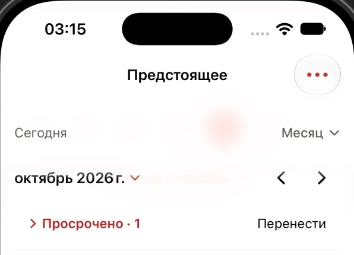

# Frosted header preview

30 October 2026. Branch `task/FROSTED-HEADER-PREVIEW`, based on `3a7c11c`.

This is an opt-in preview in Upcoming → Month. Other workspaces retain their existing surfaces pending the user's visual review. No iPhone installation, upload or push was performed.

- Uses native regular Liquid Glass on iOS 26+, tinted toward the current canvas, with a 24 pt fading bottom edge. There is no card outline or separate gray fill.
- The month scroll view reserves the fixed header through `safeAreaInset`, allowing scrolling content behind the glass. The title retains the existing scale/fade and settlement observer.
- The main header's glass backing extends through the top safe area. The separate system navigation-bar background is hidden in this preview, removing the horizontal seam between two materials. Navigation buttons keep their native treatment.
- Reduce Transparency uses the opaque theme canvas. Earlier iOS versions fall back to ultra-thin material. These fallback branches were not runtime-tested in this preview.

Simulator Debug build passed on the dedicated Orbit Productivity QA / iPhone 17 / iOS 27.0 with existing synthetic data. GUI verified: expanded and collapsed title, vertical scrolling, glass blur beneath controls, no navigation/header seam, and a horizontal swipe from October to November. No physical touch, dark-theme matrix or performance measurements are claimed.

`light-*-window.png` are original CUA window captures. `header-scrolled.png` and `month-expanded.png` are crops of the same captures; no interface pixels were retouched.

