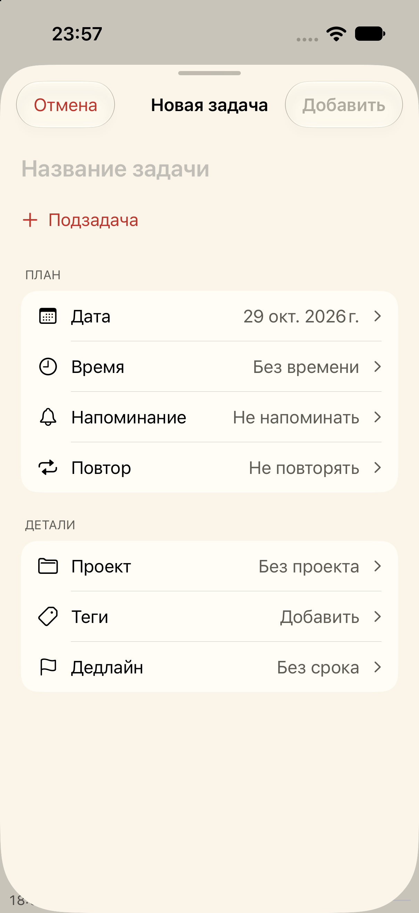
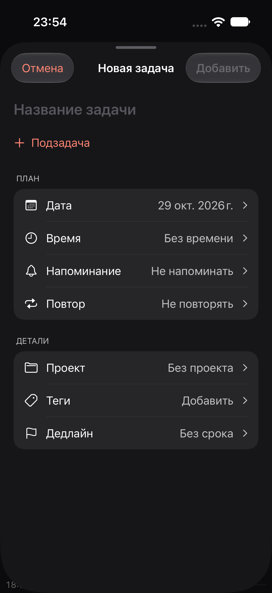
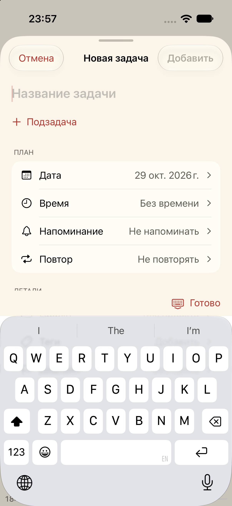

# TASK-FORM-PLAN — «Задача и план»

29 октября 2026. Реализация согласованного варианта общей формы создания и редактирования задачи.

## Изменения

- Название выделено размером title2/semibold; подзадачи вводятся и редактируются сразу под ним.
- «План»: дата, время, напоминание, повтор. «Детали»: проект, теги, дедлайн. Все параметры видны на главной форме со своими значениями; скрытого раздела «Дополнительно» больше нет.
- Строки нажимаются целиком, высота не меньше 48 pt. Длинные значения переходят на отдельную строку, а не обрезаются.
- Настройки параметров открываются внутри NavigationStack и работают с общим локальным черновиком. Время открывается сразу с колёсами начала; длительность и снятие времени доступны на том же экране.
- Cancel/Add/Save закреплены сверху. «Готово» над клавиатурой только завершает ввод. Отмена изменённого черновика запрашивает подтверждение.
- Сохранены быстрый разбор текста, ограничение количества подзадач, валидация, защита от повторного добавления, подтверждение удаления и сообщение об ошибке без потери черновика.
- Схемы данных и сигнатуры сохранения не менялись. Заметки не реализованы: такого поля пока нет в модели, поэтому кнопка из визуального концепта не показана.

## Реальные снимки

Только отдельный Simulator **Orbit Productivity QA**, iOS 27.0, синтетические задачи. Это не макеты и не проверка на физическом iPhone.

| Слоновая кость | Тёмная тема | С клавиатурой |
| --- | --- | --- |
|  |  |  |

## Проверка

- Debug build OrbitIOS для iOS Simulator: **BUILD SUCCEEDED**.
- Существующие тесты `TaskEditorTests|ProductivityTests`: 11 тестов в 2 suites, успешный запуск. Проверка миграции v2 отмечена тестовым раннером как skipped; миграция этой задачей не менялась и не подтверждается этим запуском.
- В GUI создана задача с длинным названием, подзадачей Research и интервалом 09:00–09:30. После сохранения и повторного открытия эти значения сохранены.
- Выбор «По будням» возвращается в сводку; отмена после изменения показывает подтверждение, сброс закрывает форму.
- Напоминание для начала в 09:00 получает 08:50. Запрет уведомлений отображается явно. Сохранение прошедшего напоминания отклонено с сообщением, черновик сохранён; после отключения напоминания задача добавилась.
- Проверены пустая форма, disabled Add, перенос длинного названия, ввод подзадачи, переход к времени и возврат, показ всех семи параметров без клавиатуры в тёмной теме и слоновой кости.
- Финальная сборка: кнопка «Готово» видна над программной клавиатурой и скрывает её одним нажатием. Верхние действия остаются видны.
- `git diff --check`: без ошибок.

Ограничения: физический iPhone, VoiceOver, все темы/размеры Dynamic Type и доставка уведомлений не проверялись. Прокрутку касанием при открытой клавиатуре через Device Hub подтвердить не удалось: жесты инструмента не дали наблюдаемого изменения; доступ ко всем параметрам проверен после явного скрытия клавиатуры. Поведение следует дополнительно пройти на устройстве. Никакой установки на телефон или публикации в этой задаче не выполнялось.
