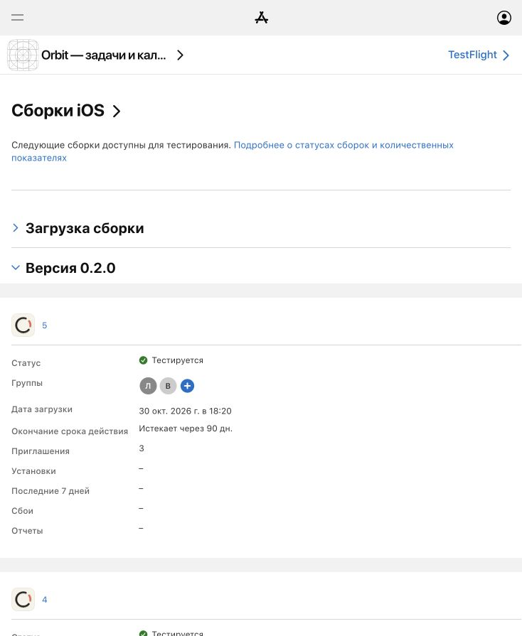

# TestFlight 0.2.0 (5)

**30 октября 2026.** Пользователь разрешил обновить GitHub, README и скриншоты, затем выпустить новую сборку в TestFlight. Публикация в App Store не входит в этот выпуск.

## Состав

- Исходная версия: `9f5d92c` — накопленные изменения после сборки (4), включая общее непрерывное движение шапок, доводку на краях прокрутки и компактную шапку трёхдневного календаря.
- Номер сборки приложения и WidgetKit-расширения повышен с **4** до **5**. Версия — **0.2.0**.
- README переписан по текущей реализации; устаревшие описания редактора, тегов и формата копии обновлены.
- Галерея: четыре свежих оригинальных скриншота — список дня, календарь дня, три дня, проекты/теги. [Условия съёмки](../../docs/screenshots/README.md).

## Проверки

| Проверка | Результат |
| :--- | :--- |
| `swift test --package-path apple/Orbit` | **PASS — 153 теста / 26 наборов**. |
| Simulator Debug: приложение и виджет | **BUILD SUCCEEDED**. |
| Release archive для iOS | **ARCHIVE SUCCEEDED**. |
| App Store export | **EXPORT SUCCEEDED**. |
| `codesign --verify --deep --strict` для экспортированного приложения | **PASS**. |
| Версии в IPA | `local.orbit.ios` и `local.orbit.ios.widgets`: **0.2.0 (5)**. |
| Размер экспортированного IPA | **4,41 МиБ**. Размер установки определяется Apple отдельно. |
| Загрузка в App Store Connect | **Upload succeeded / EXPORT SUCCEEDED**. |

Загрузка завершилась 30 октября в 18:16 по журналу Xcode. В App Store Connect сборка появилась как **0.2.0 (5)**, ID `1712edde-cbb5-4fcc-8f3c-f1bbfd3f6792`; состояние двоичного файла — **«Подтвержден»**, использование шифрования, не подпадающего под исключения — **«Нет»**.

Обработка завершена. В App Store Connect подтверждён статус **«Тестируется»** и обе группы: **«Личное тестирование»** и **«Внешний тест»**. Русское описание изменений сохранено; при отправке внешней группе флаг **«Автоматически уведомлять тестировщиков»** включён. Новая проверка не осталась в ожидании. Фактическая установка обновления каждым тестировщиком отдельно не проверялась.

Архив, IPA, профили, сертификаты и полные журналы оставлены вне Git в `/private/tmp/`. Сборка и загрузка выполнены через Xcode с автоматической подписью, без добавления ключей или учётных данных в репозиторий.

## Что проверить в бете

Прокрутка и сворачивание шапок стали плавнее. Исправлены скачки заголовка и поведение на краях календаря. В «Предстоящем» шапка режима «3 дня» стала компактнее; заголовок месяца больше не закрепляется отдельной панелью. Проверьте прокрутку, переключение видов и перенос задач на своих данных.

## Границы

Для галереи использован только новый Simulator с синтетическими данными. Снимки подтверждают вид четырёх экранов, а не полный проход жестов, тем и всех устройств. Эта задача не включает новую прямую установку на iPhone. Полная визуальная приёмка medium/Lock Screen виджетов, старых iOS и физическая доставка уведомлений остаются отдельными проверками.

Незавершённые локальные материалы `HANDOFF-2026-10-25.md` и `reports/UX-AUDIT-2026-10-29/` не входят в этот коммит и не удаляются.
